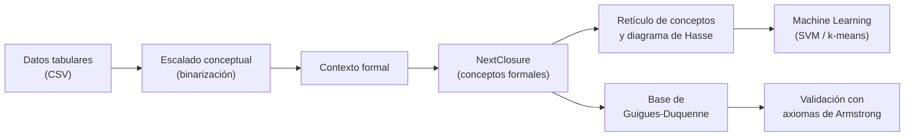

<div align="center">

# Análisis Formal de Conceptos para el Análisis de Bases de Datos

**Retículos de conceptos, implicaciones y dependencias funcionales sobre datos reales**

Proyecto académico · Análisis de Bases de Datos
Universidad Nacional de Colombia · Ciencias de la Computación


</div>

---

## Tabla de contenido

- [Descripción](#descripción)
- [Motivación](#motivación)
- [Objetivos](#objetivos)
- [Datasets](#datasets)
- [Metodología](#metodología)
- [Estructura del repositorio](#estructura-del-repositorio)
- [Tecnologías](#tecnologías)
- [Instalación y uso](#instalación-y-uso)
- [Hoja de ruta](#hoja-de-ruta)
- [Documentación](#documentación)
- [Equipo](#equipo)
- [Información académica](#información-académica)
- [Referencias](#referencias)

---

## Descripción

Este repositorio contiene la implementación de un pipeline completo de **Análisis Formal de Conceptos** (FCA, por sus siglas en inglés) aplicado al análisis de bases de datos. El proyecto parte de datos tabulares reales, los transforma en un contexto formal binario y, a partir de él, construye el retículo de conceptos, extrae un conjunto mínimo de implicaciones entre atributos y las valida a la luz de la teoría de dependencias funcionales de bases de datos relacionales.

Como fase final, se explora el uso de los conceptos formales obtenidos como representación de características para tareas de aprendizaje automático (clasificación y agrupamiento).

Todos los algoritmos centrales se implementan desde cero, con el fin de estudiar su funcionamiento y verificar su corrección, en lugar de depender de librerías especializadas de FCA.

## Motivación

El Análisis Formal de Conceptos es un marco matemático que organiza un conjunto de datos en **conceptos**: grupos de objetos que comparten exactamente un mismo conjunto de atributos. Estos conceptos se ordenan naturalmente en una jerarquía, lo que permite visualizar la estructura interna de los datos de forma clara.

Lo que hace a FCA especialmente relevante para el estudio de bases de datos es que, de esa jerarquía, se pueden extraer **implicaciones** del tipo *"todo objeto que tiene los atributos A también tiene los atributos B"*. Estas implicaciones guardan una relación directa con las **dependencias funcionales** del modelo relacional, por lo que FCA ofrece una forma rigurosa de descubrir, compactar y validar dependencias a partir de los datos mismos.

## Objetivos

### Objetivo general

Diseñar e implementar un pipeline de Análisis Formal de Conceptos que permita descubrir y validar la estructura de dependencias de un conjunto de datos, y evaluar su utilidad como herramienta de representación en tareas de aprendizaje automático.

### Objetivos específicos

1. **Preparar los datos:** transformar datasets con atributos cualitativos y numéricos en contextos formales binarios mediante técnicas de escalado conceptual.
2. **Calcular los conceptos formales:** implementar el algoritmo *NextClosure* para obtener todos los conceptos del contexto y construir su retículo, junto con su representación gráfica como diagrama de Hasse.
3. **Extraer implicaciones:** obtener la base canónica de *Guigues-Duquenne*, es decir, el conjunto mínimo y no redundante de implicaciones que describe los datos.
4. **Validar formalmente:** verificar las dependencias obtenidas mediante los *axiomas de Armstrong*, el cálculo de clausuras de atributos y la identificación de claves candidatas.
5. **Aplicar a Machine Learning:** utilizar los conceptos formales como nuevas características para entrenar modelos de clasificación (SVM) y agrupamiento (*k-means*), comparando su desempeño frente a la representación original.

## Datasets

Se evaluaran tres conjuntos de datos según su naturaleza y su idoneidad para FCA:

| Dataset | Tipo de datos | Rol en el proyecto |
|---|---|---|
| **Animal Species** | Atributos cualitativos y binarios (plumas, leche, alas, etc.) | Dataset de referencia para depurar y validar la corrección de los algoritmos |
| **Breast Cancer Wisconsin** | Atributos numéricos continuos (radio, textura, área, etc.) y clase binaria (maligno / benigno) | Dataset principal para el pipeline completo, incluida la fase de Machine Learning |
| **Spotify Recommendation** | Variables mixtas (características de audio y metadatos) | Evaluado, pero descartado por ahora |

**Estrategia de trabajo.** Primero se utiliza *Animal Species*, cuya estructura ya es binaria y de tamaño reducido, lo que permite verificar manualmente los resultados de cada algoritmo. Una vez validada la implementación, el pipeline completo se aplica sobre *Breast Cancer Wisconsin*, que exige un esquema explícito de discretización y es el más adecuado para la fase de aprendizaje automático.

El dataset de *Spotify* se descartó para esta primera implementación: tras la discretización genera un contexto muy denso, lo que provoca un crecimiento combinatorio en el número de conceptos y vuelve impráctico su cálculo y visualización.

## Metodología

El proyecto se organiza como un pipeline de cinco fases:



1. **Normalización y escalado conceptual.** Los datos originales se convierten en una tabla binaria de objetos por atributos. Las variables continuas se discretizan en intervalos (por ejemplo, por cuantiles) y luego se codifican de forma nominal u ordinal.
2. **Derivación de conceptos formales.** Con el algoritmo *NextClosure* se generan, de forma determinista y sin repeticiones, todos los conceptos del contexto. Con ellos se construye el retículo y se exporta su diagrama de Hasse.
3. **Extracción de la base canónica.** Se identifican los pseudo-intentos del contexto para obtener la base de *Guigues-Duquenne*: el conjunto más pequeño posible de implicaciones a partir del cual se pueden deducir todas las demás.
4. **Validación axiomática.** Las dependencias obtenidas se verifican computacionalmente mediante clausuras de atributos y los axiomas de Armstrong (reflexividad, aumentación y transitividad), y se calculan las claves candidatas.
5. **Experimentación en Machine Learning.** Los conceptos del retículo se usan como nuevas características binarias para entrenar modelos SVM y *k-means*, y se compara su desempeño frente al uso de los datos sin FCA.

> Los fundamentos teóricos, las demostraciones y el pseudocódigo de cada algoritmo se irán incorporando a este documento a medida que avance el proyecto.

## Estructura del repositorio

```
fca-database-analysis/
├── README.md
├── requirements.txt
├── environment.yml
├── setup.py
├── data/
│   ├── raw/                  # Datasets originales (CSV)
│   ├── processed/            # Datos limpios y binarizados
│   └── contexts/             # Contextos formales (.cxt o .json)
├── docs/
│   ├── report.pdf            # Informe escrito en LaTeX
│   └── presentation.pdf      # Presentación del proyecto
├── notebooks/
│   ├── 01_data_preprocessing.ipynb   # Carga, limpieza y binarización
│   ├── 02_fca_execution.ipynb        # NextClosure y construcción del retículo
│   ├── 03_guigues_duquenne.ipynb     # Base canónica y axiomas de Armstrong
│   └── 04_ml_experiments.ipynb       # Reducción de dimensionalidad y SVM / k-means
├── src/
│   ├── preprocessing/
│   │   └── scaler.py         # Escalado nominal, ordinal y por cuantiles
│   ├── fca/
│   │   ├── context.py        # Clase FormalContext
│   │   ├── algorithms.py     # NextClosure y operadores de derivación
│   │   └── lattice.py        # Clase ConceptLattice y exportación del diagrama de Hasse
│   ├── implications/
│   │   ├── guigues_duquenne.py   # Extracción de pseudo-intentos
│   │   └── armstrong.py          # Clausura de atributos y validación axiomática
│   └── ml/
│       └── pipeline.py       # Extracción de características basada en el retículo + SVM
└── tests/
    ├── test_context.py       # Pruebas de los operadores de derivación
    ├── test_next_closure.py  # Verificación de NextClosure con ejemplos conocidos
    └── test_armstrong.py     # Validación de clausuras y dependencias
```

> Esta es la estructura planeada; algunos archivos y carpetas aún no existen y se irán creando durante el desarrollo.

## Tecnologías

- **Python 3** como lenguaje principal.
- **Pandas** para la carga y transformación de datos.
- **Graphviz / NetworkX** para la visualización del retículo y los diagramas de Hasse.
- **scikit-learn** para los modelos SVM y *k-means*.
- **Jupyter Notebooks** para la experimentación y presentación de resultados.
- **pytest** para las pruebas unitarias.
- **LaTeX** para el informe final.

## Hoja de ruta

- [ ] **Fase 1 — Preparación de datos:** carga, limpieza y escalado conceptual de los datasets.
- [ ] **Fase 2 — Núcleo FCA:** clase `FormalContext`, operadores de derivación, *NextClosure* y diagrama de Hasse.
- [ ] **Fase 3 — Implicaciones:** base de *Guigues-Duquenne*, clausuras de atributos y axiomas de Armstrong.
- [ ] **Fase 4 — Machine Learning:** extracción de características a partir de conceptos y comparación de modelos.
- [ ] **Fase 5 — Pruebas y documentación:** pruebas unitarias, informe en LaTeX y presentación final.

## Documentación

A medida que el proyecto avance, este README y la carpeta `docs/` irán incorporando:

- Fundamentos teóricos de FCA, implicaciones y dependencias funcionales.
- Demostraciones de los resultados utilizados.
- Pseudocódigo y explicación detallada de cada algoritmo.
- Resultados experimentales y análisis.
- Informe final (`docs/report.pdf`) y presentación (`docs/presentation.pdf`).

## Equipo

| Nombre | GitHub | Correo |
|---|---|---|
| Tomas Jerez | [@TomasJerezG](https://github.com/TomasJerezG) | tjerez@unal.edu.co |
| Juan Huertas | [@spartan14799](https://github.com/spartan14799) | jhuertass@unal.edu.co |
| Martin Hernandez | [@Bl4ky113](https://github.com/Bl4ky113) | mahernandezor@unal.edu.co |
| Angel Arevalo | [@Angel-Arevalo](https://github.com/Angel-Arevalo) | anarevalof@unal.edu.co |

## Información académica

| | |
|---|---|
| **Universidad** | Universidad Nacional de Colombia — BOGOTA |
| **Programa** | Ciencias de la Computación |
| **Asignatura** | Análisis de Bases de Datos |
| **Docente** | Humberto Sarria |
| **Periodo** | 2026-2 |

## Referencias

- B. Ganter y R. Wille. *Formal Concept Analysis: Mathematical Foundations*. Springer, 1999.
- B. Ganter. "Two Basic Algorithms in Concept Analysis". En *Formal Concept Analysis (ICFCA 2010)*, LNCS 5986, Springer, 2010.
- J.-L. Guigues y V. Duquenne. "Familles minimales d'implications informatives résultant d'un tableau de données binaires". *Mathématiques et Sciences Humaines*, 95, 1986.
- W. W. Armstrong. "Dependency Structures of Data Base Relationships". *Proceedings of the IFIP Congress*, 1974.
