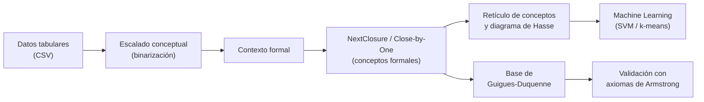

<div align="center">

# Análisis Formal de Conceptos para el Análisis de Bases de Datos

**Retículos de conceptos, implicaciones y dependencias funcionales sobre datos reales**

Proyecto académico · Análisis de Bases de Datos
Universidad Nacional de Colombia · Ciencias de la Computación


</div>

---

## Tabla de contenido

- [Descripción](#descripción)
- [Motivación](#motivación)
- [Objetivos](#objetivos)
- [Datasets](#datasets)
- [Metodología](#metodología)
- [Estructura del repositorio](#estructura-del-repositorio)
- [Uso](#uso)
- [Tecnologías](#tecnologías)
- [Hoja de ruta](#hoja-de-ruta)
- [Documentación](#documentación)
- [Equipo](#equipo)
- [Información académica](#información-académica)
- [Referencias](#referencias)

---

## Descripción

Este repositorio contiene la implementación de un pipeline completo de **Análisis Formal de Conceptos** (FCA, por sus siglas en inglés) aplicado al análisis de bases de datos. El proyecto parte de datos tabulares reales, los transforma en un contexto formal binario y, a partir de él, construye el retículo de conceptos, extrae un conjunto mínimo de implicaciones entre atributos y las valida a la luz de la teoría de dependencias funcionales de bases de datos relacionales.

Como fase final, se explora el uso de los conceptos formales obtenidos como representación de características para tareas de aprendizaje automático (clasificación y agrupamiento).

Todos los algoritmos centrales se implementan desde cero, con el fin de estudiar su funcionamiento y verificar su corrección, en lugar de depender de librerías especializadas de FCA.

## Motivación

El Análisis Formal de Conceptos es un marco matemático que organiza un conjunto de datos en **conceptos**: grupos de objetos que comparten exactamente un mismo conjunto de atributos. Estos conceptos se ordenan naturalmente en una jerarquía, lo que permite visualizar la estructura interna de los datos de forma clara.

Lo que hace a FCA especialmente relevante para el estudio de bases de datos es que, de esa jerarquía, se pueden extraer **implicaciones** del tipo *"todo objeto que tiene los atributos A también tiene los atributos B"*. Estas implicaciones guardan una relación directa con las **dependencias funcionales** del modelo relacional, por lo que FCA ofrece una forma rigurosa de descubrir, compactar y validar dependencias a partir de los datos mismos.

## Objetivos

### Objetivo general

Diseñar e implementar un pipeline de Análisis Formal de Conceptos que permita descubrir y validar la estructura de dependencias de un conjunto de datos, y evaluar su utilidad como herramienta de representación en tareas de aprendizaje automático.

### Objetivos específicos

1. **Preparar los datos:** transformar datasets con atributos cualitativos y numéricos en contextos formales binarios mediante técnicas de escalado conceptual.
2. **Calcular los conceptos formales:** implementar el algoritmo *NextClosure* para obtener todos los conceptos del contexto y construir su retículo, junto con su representación gráfica como diagrama de Hasse.
3. **Extraer implicaciones:** obtener la base canónica de *Guigues-Duquenne*, es decir, el conjunto mínimo y no redundante de implicaciones que describe los datos.
4. **Validar formalmente:** verificar las dependencias obtenidas mediante los *axiomas de Armstrong*, el cálculo de clausuras de atributos y la identificación de claves candidatas.
5. **Aplicar a Machine Learning: (Opcional)** utilizar los conceptos formales como nuevas características para entrenar modelos de clasificación (SVM) y agrupamiento (*k-means*), comparando su desempeño frente a la representación original.

## Datasets

Se evaluarán tres conjuntos de datos según su naturaleza y su idoneidad para FCA:

| Dataset | Tipo de datos | Rol en el proyecto | Estado |
|---|---|---|---|
| **[Animal Species](https://www.kaggle.com/datasets/kennyloic/animal-species-data)** | 200 registros y 10 columnas: 3 numéricas (velocidad, peso y longevidad) y 7 categóricas (tipo, nombre, continente, país, migración, reproducción y nivel de amenaza). Licencia CC0 | Dataset de referencia para depurar y validar la corrección de los algoritmos | Preprocesado ([notebook 01](notebooks/01_data_preprocessing.ipynb)) |
| **Breast Cancer Wisconsin** | Atributos numéricos continuos (radio, textura, área, etc.) y clase binaria (maligno / benigno) | Dataset principal para el pipeline completo, incluida la fase de Machine Learning si es posible | Pendiente |
| **Spotify Recommendation** | Variables mixtas (características de audio y metadatos) | Por definir | En evaluación |

**Estrategia de trabajo.** Primero se utiliza *Animal Species*, que es pequeño (200 registros) y combina variables numéricas y categóricas, así que pone a prueba todo el preprocesamiento: discretización, escalado nominal y escalado ordinal. Una vez validada la implementación, el pipeline completo se aplica sobre *Breast Cancer Wisconsin*, que es el más adecuado para la fase de aprendizaje automático.

La revisión de calidad del [notebook 01](notebooks/01_data_preprocessing.ipynb) mostró que los datos de *Animal Species* parecen generados al azar: cada país aparece en los cinco continentes, cerca de la mitad de los mamíferos pone huevos y la única relación real entre columnas es que un mismo nombre de animal siempre tiene el mismo tipo. Por eso este dataset sirve para validar los algoritmos, pero no para sacar conclusiones sobre los animales.

El dataset de *Spotify* sigue en evaluación. Sus atributos de audio y de género pueden dar reglas de asociación interesantes, pero tras la discretización tiende a generar un contexto muy denso, lo que puede provocar un crecimiento combinatorio en el número de conceptos y dificultar su cálculo y visualización. Para usarlo habrá que controlar el tamaño del contexto, por ejemplo con menos intervalos por variable o con un subconjunto de los atributos.

## Metodología

El proyecto se organiza como un pipeline de cinco fases:



1. **Normalización y escalado conceptual.** Primero se revisan la calidad y la coherencia de los datos, y después se convierten en una tabla binaria de objetos por atributos. Las variables numéricas se discretizan en intervalos (de igual ancho, de igual frecuencia o con *k-means* en una dimensión), con un número de intervalos fijo o elegido con las reglas de Sturges, Freedman–Diaconis o Scott. Luego cada variable se codifica con una escala nominal u ordinal, y el resultado es la matriz de incidencia del contexto formal.
2. **Derivación de conceptos formales.** Con el algoritmo *NextClosure* se generan, de forma determinista y sin repeticiones, todos los conceptos del contexto. El algoritmo *Close-by-One* produce los mismos conceptos en el mismo orden, junto con las aristas del retículo, y con ellas se dibuja el diagrama de Hasse.
3. **Extracción de la base canónica.** Se identifican los pseudo-intentos del contexto para obtener la base de *Guigues-Duquenne*: el conjunto más pequeño posible de implicaciones a partir del cual se pueden deducir todas las demás.
4. **Validación axiomática.** Las dependencias obtenidas se verifican computacionalmente mediante clausuras de atributos y los axiomas de Armstrong (reflexividad, aumentación y transitividad), y se calculan las claves candidatas.
5. **Experimentación en Machine Learning.** Los conceptos del retículo se usan como nuevas características binarias para entrenar modelos SVM y *k-means*, y se compara su desempeño frente al uso de los datos sin FCA.

> Los fundamentos teóricos y las demostraciones están en [`docs/teoria/teoria.pdf`](docs/teoria/teoria.pdf) (fuentes en LaTeX en [`docs/teoria/`](docs/teoria/)), y la explicación y el pseudocódigo de cada módulo en [`docs/codigo/`](docs/codigo/). Ambos se amplían a medida que avanza el proyecto.

## Estructura del repositorio

La columna de la derecha indica lo que falta: **pendiente** significa que el archivo todavía no existe o está vacío, y **en progreso**, que existe pero está incompleto. Todo lo demás ya está en el repositorio.

```
PR-ABD/
├── README.md
├── LICENSE
├── requirements.txt                       # Dependencias de Python
├── pyproject.toml                         # Configuración de pytest
├── data/
│   ├── raw/                               # Datasets originales (CSV)
│   │   ├── animal_species_200_rows.csv    # Animal Species (licencia CC0)
│   │   └── breast_cancer_wisconsin.csv    # Breast Cancer Wisconsin               pendiente
│   ├── processed/                         # Datos discretizados y binarizados
│   │   ├── animales_discretizado.csv      # Variables numéricas como intervalos
│   │   └── animales_contexto.csv          # Contexto formal como tabla de 0 y 1
│   └── contexts/                          # Contextos formales en formato .cxt
│       └── animales.cxt                   # Contexto para otros programas de FCA
├── docs/
│   ├── teoria/                            # Fundamentos teóricos en LaTeX
│   │   ├── teoria.tex                     # Documento principal
│   │   ├── preambulo.tex                  # Paquetes, teoremas y macros
│   │   ├── referencias.bib                # Bibliografía (biber)
│   │   ├── secciones/                     # Un archivo por fase
│   │   │   ├── 01_contexto_formal.tex     # Contexto formal y escalado
│   │   │   ├── 02_conceptos_formales.tex  # Conceptos formales y NextClosure      pendiente
│   │   │   ├── 03_guigues_duquenne.tex    # Implicaciones y Guigues-Duquenne      pendiente
│   │   │   ├── 04_armstrong.tex           # Dependencias funcionales y Armstrong  pendiente
│   │   │   └── 05_machine_learning.tex    # Conceptos como características        pendiente
│   │   └── teoria.pdf                     # Versión compilada
│   ├── codigo/                            # Un .md por cada archivo de src/
│   │   ├── preprocessing/
│   │   │   ├── quantiles.md
│   │   │   ├── cuant_type.md
│   │   │   └── scaler.md
│   │   ├── fca/                                                                   pendiente
│   │   │   ├── context.md                                                         pendiente
│   │   │   ├── lattice.md                                                         pendiente
│   │   │   └── lattice_plot.md                                                    pendiente
│   │   ├── implications/                                                          pendiente
│   │   │   ├── guigues_duquenne.md                                                pendiente
│   │   │   └── armstrong.md                                                       pendiente
│   │   └── ml/                                                                    pendiente
│   │       └── pipeline.md                                                        pendiente
│   ├── report.pdf                         # Informe final en LaTeX                pendiente
│   └── presentation.pdf                   # Presentación del proyecto             pendiente
├── notebooks/
│   ├── 01_data_preprocessing.ipynb        # Preprocesamiento de Animal Species
│   ├── 02_fca_execution.ipynb             # Conceptos y diagrama de Hasse         pendiente
│   ├── 03_guigues_duquenne.ipynb          # Implicaciones y dependencias          pendiente
│   └── 04_ml_experiments.ipynb            # Experimentos con SVM y k-means        pendiente
├── src/
│   ├── preprocessing/
│   │   ├── quantiles.py                   # Reglas para el número de intervalos
│   │   ├── cuant_type.py                  # Métodos de discretización
│   │   └── scaler.py                      # Discretización y escalado conceptual
│   ├── fca/
│   │   ├── context.py                     # FormalContext y NextClosure
│   │   ├── lattice.py                     # Close-by-One y aristas del retículo
│   │   └── lattice_plot.py                # Dibujo del diagrama de Hasse
│   ├── implications/
│   │   ├── guigues_duquenne.py            # Base canónica de Guigues-Duquenne
│   │   └── armstrong.py                   # Clausura, dependencias y claves       en progreso
│   └── ml/                                                                        pendiente
│       └── pipeline.py                    # Pipeline de aprendizaje automático    pendiente
└── tests/                                 # Pruebas con pytest
    ├── README.md                          # Guía de las pruebas
    ├── utilidades.py                      # Versiones de fuerza bruta
    └── test_*.py                          # Pruebas de cada módulo de src/
```

## Uso

Se necesita Python 3.10 o superior. Desde la raíz del repositorio:

```bash
python -m pip install -r requirements.txt   # instala las dependencias
python -m pytest                            # ejecuta las pruebas
```

En [`tests/README.md`](tests/README.md) se explica cómo leer el resultado de las pruebas. Los notebooks de [`notebooks/`](notebooks/) se abren con Jupyter o con VS Code y se ejecutan de arriba abajo. El primero lee `data/raw/` y guarda sus resultados en `data/processed/` y `data/contexts/`.

En el código, los módulos de `src/` se importan sin el prefijo `src.`, por ejemplo `from fca.context import FormalContext`. pytest y los notebooks agregan `src/` a la ruta de Python automáticamente.

## Tecnologías

- **Python 3.10 o superior** como lenguaje principal.
- **Pandas** para la carga y transformación de datos.
- **NumPy** para el cálculo numérico de la discretización y el escalado.
- **Matplotlib** para las gráficas y el dibujo de los diagramas de Hasse.
- **scikit-learn** para los modelos SVM y *k-means* de la fase de Machine Learning.
- **Jupyter Notebooks** para la experimentación y presentación de resultados.
- **pytest** para las pruebas unitarias.
- **LaTeX** para los fundamentos teóricos y el informe final.

## Hoja de ruta

- [ ] **Fase 1 — Preparación de datos**
  - [x] Discretización y escalado conceptual (`src/preprocessing/`).
  - [x] *Animal Species*: revisión de calidad, discretización y contexto formal ([notebook 01](notebooks/01_data_preprocessing.ipynb)).
  - [ ] *Breast Cancer Wisconsin*.
- [ ] **Fase 2 — Núcleo FCA**
  - [x] Clase `FormalContext`, operadores de derivación y *NextClosure*.
  - [x] *Close-by-One*, retículo de conceptos y dibujo del diagrama de Hasse.
  - [ ] Notebook 02: conceptos y retículo de los datasets.
- [ ] **Fase 3 — Implicaciones**
  - [x] Base de *Guigues-Duquenne* y clausura de atributos.
  - [ ] Dependencias funcionales y claves candidatas.
  - [ ] Notebook 03: implicaciones, axiomas de Armstrong y dependencias.
- [ ] **Fase 4 — Machine Learning (opcional)**
  - [ ] Extracción de características a partir de conceptos y comparación de modelos.
- [ ] **Fase 5 — Pruebas y documentación**
  - [x] Pruebas con pytest de todos los módulos actuales ([`tests/README.md`](tests/README.md)).
  - [x] Teoría de la Fase 1 y documentación del código de `preprocessing`.
  - [ ] Teoría de las fases 2 a 4 y documentación del código de `fca` e `implications`.
  - [ ] Informe final y presentación.

## Documentación

La documentación técnica está en la carpeta [`docs/`](docs/):

| Documento | Contenido |
|---|---|
| [Fundamentos teóricos](docs/teoria/teoria.pdf) | Definiciones, proposiciones, teoremas y demostraciones de cada fase, en LaTeX ([fuentes](docs/teoria/)). Por ahora cubre la Fase 1: contextos formales, escalado conceptual y discretización. |
| [`quantiles.py`](docs/codigo/preprocessing/quantiles.md) | Reglas para elegir el número de intervalos: Sturges, Freedman–Diaconis y Scott. |
| [`cuant_type.py`](docs/codigo/preprocessing/cuant_type.md) | Métodos de discretización: igual ancho, igual frecuencia y *k-means* en una dimensión. |
| [`scaler.py`](docs/codigo/preprocessing/scaler.md) | Discretización de la tabla y escalado nominal u ordinal hasta la matriz de incidencia. |

Las pruebas tienen su propia guía en [`tests/README.md`](tests/README.md): cómo ejecutarlas, cómo leer el resultado y qué comprueba cada archivo.

Para compilar la teoría, ejecutar `latexmk -pdf teoria.tex` (pdfLaTeX) o `latexmk -xelatex teoria.tex` (XeLaTeX) dentro de `docs/teoria/`, o subir esa carpeta a Overleaf. En los dos casos se necesita biber para la bibliografía.

Cada documento de código explica el módulo e incluye su pseudocódigo, su complejidad, los casos borde y un ejemplo de uso. Faltan los documentos de los módulos de `fca/` e `implications/`, el informe final (`docs/report.pdf`) y la presentación (`docs/presentation.pdf`).

## Equipo

| Nombre | GitHub | Correo |
|---|---|---|
| Tomas Jerez | [@TomasJerezG](https://github.com/TomasJerezG) | tjerez@unal.edu.co |
| Juan Huertas | [@spartan14799](https://github.com/spartan14799) | jhuertass@unal.edu.co |
| Martin Hernandez | [@Bl4ky113](https://github.com/Bl4ky113) | mahernandezor@unal.edu.co |
| Angel Arevalo | [@Angel-Arevalo](https://github.com/Angel-Arevalo) | anarevalof@unal.edu.co |

## Información académica

| | |
|---|---|
| **Universidad** | Universidad Nacional de Colombia — BOGOTA |
| **Programa** | Ciencias de la Computación |
| **Asignatura** | Análisis de Bases de Datos |
| **Docente** | Humberto Sarria |
| **Periodo** | 2026-2 |

## Referencias

- B. Ganter y R. Wille. *Formal Concept Analysis: Mathematical Foundations*. Springer, 1999.
- B. Ganter. "Two Basic Algorithms in Concept Analysis". En *Formal Concept Analysis (ICFCA 2010)*, LNCS 5986, Springer, 2010.
- J.-L. Guigues y V. Duquenne. "Familles minimales d'implications informatives résultant d'un tableau de données binaires". *Mathématiques et Sciences Humaines*, 95, 1986.
- W. W. Armstrong. "Dependency Structures of Data Base Relationships". *Proceedings of the IFIP Congress*, 1974.
